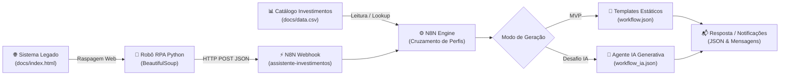

# 🚀 Assistente de Investimentos com RPA e IA Generativa

<p align="center">
  
  
  
  
  
</p>

---

## 📖 Visão Geral

Este projeto foi desenvolvido como solução completa do desafio prático **"Criando um Assistente de Investimentos com RPA e IA Generativa"** da [Digital Innovation One (DIO)](https://www.dio.me/).

O objetivo principal é construir um **pipeline de automação inteligente de ponta a ponta** aplicável a cenários reais do mercado financeiro, combinando:
1. **RPA (Robotic Process Automation) com Python & BeautifulSoup:** extração automatizada de dados de clientes simulando uma consulta em sistema bancário legado sem API.
2. **Orquestração de Dados com N8N:** ingestão via Webhook, cruzamento com catálogo de investimentos em CSV e aplicação de regras de negócio por perfil de risco.
3. **Comunicação Personalizada (MVP & IA Generativa):**
   - **MVP:** Geração de recomendações com templates estáticos para perfis *Conservador*, *Moderado* e *Arrojado*.
   - **Desafio Avançado:** Geração dinâmica de mensagens consultivas e humanizadas através de **Agente de IA Generativa** (LLM).

---

## 🏗️ Arquitetura da Solução

O fluxo integra os componentes de forma desacoplada, escalável e resiliente:



---

## 📁 Estrutura do Repositório

```text
dio-lab-assistente-investimentos-rpa-n8n/
│
├── README.md                      # Documentação completa do projeto e guia de execução
│
├── docs/
│   ├── index.html                 # Página HTML simulada com tabela de clientes legada
│   └── data.csv                   # Catálogo de opções de investimento categorizadas por perfil
│
├── src/
│   ├── extrair_clientes.ipynb     # Jupyter Notebook com o passo a passo de RPA (Google Colab)
│   ├── extrair_clientes.py        # Script Python executável via CLI com suporte a flags
│   └── testar_fluxo_local.py      # Script de teste e demonstração local ponta a ponta
│
└── n8n/
    ├── workflow.json              # 🎯 MVP: Fluxo N8N com Webhook, CSV e templates estáticos
    └── workflow_ia.json           # 🚀 Desafio Completo: Fluxo N8N integrado com Agente de IA
```

---

## 🤖 Por que o script Python é considerado RPA?

No universo corporativo, especialmente em instituições financeiras tradicionais, é muito comum encontrar **sistemas legados** que não possuem APIs REST, Webhooks ou integrações modernas.

Nessa realidade, um operador humano precisaria:
1. Abrir a aplicação web interna no navegador;
2. Localizar visualmente a tabela de clientes;
3. Copiar manualmente linha por linha (nome, e-mail, saldo e perfil de investidor);
4. Abrir outra ferramenta de CRM ou mensageria e colar esses dados.

O script em Python atua como um **robô de software (RPA)** porque ele emula exatamente a ação humana: conecta-se ao portal, interpreta a estrutura visual (DOM) com **BeautifulSoup**, limpa e normaliza os campos numéricos e dispara os registros em formato estruturado (JSON) para a próxima etapa do fluxo.

---

## 📊 Matriz de Investimentos (`docs/data.csv`)

O catálogo de investimentos foi organizado por perfil de adequação (*suitability*):

| Perfil | Tipo de Ativo | Produto | Rentabilidade Indicativa | Nível de Risco | Proposta de Valor |
| :--- | :--- | :--- | :--- | :--- | :--- |
| **Conservador** | Renda Fixa | Tesouro Selic 2029 | 100% da Taxa Selic | Baixo | Liquidez diária e segurança soberana do Tesouro Nacional. |
| **Conservador** | Renda Fixa | CDB Liquidez Diária | 102% do CDI | Baixo | Garantia do FGC até R$ 250 mil por CPF/instituição. |
| **Conservador** | Renda Fixa | LCI/LCA Crédito Seguro | 92% do CDI (Isento IR) | Baixo | Isenção total de Imposto de Renda para pessoa física. |
| **Moderado** | Renda Fixa / Híbrido | Tesouro IPCA+ 2035 | IPCA + 6,20% a.a. | Médio | Blindagem contra inflação com ganho real contratado. |
| **Moderado** | Fundos | Fundo Multimercado Macro | CDI + 2,50% a.a. | Médio | Diversificação estratégica entre juros, moedas e bolsa. |
| **Moderado** | FIIs | FII Tijolo Corporativo (HGRE11) | Dividend Yield 9,5% a.a. | Médio | Renda passiva mensal isenta de IR com imóveis corporativos. |
| **Arrojado** | Ações Brasil | Carteira Dividendos & Valor | Ibovespa + 5,0% a.a. | Alto | Empresas líderes com fortes proventos e valorização. |
| **Arrojado** | Internacional | ETF IVVB11 (S&P 500) | Retorno S&P 500 em Dólar | Alto | Exposição às 500 maiores empresas do mercado americano. |
| **Arrojado** | Ações Brasil | Fundo Small Caps | Alpha superior a 18% a.a. | Alto | Foco em empresas com alto potencial de multiplicação. |

---

## 🚀 Como Executei o Projeto

### Etapa 1: Configurei e Subi o N8N

Utilizei o **N8N Cloud** (gratuito para testes):

```bash
[N8N](https://renan-oliveira.app.n8n.cloud/workflow/3so1lR6E1oa21gG1?projectId=nakX2zOzv6Ij7EiG).

---

### Etapa 2: Executei o Robô RPA no Google Colab
[Google Colab](https://colab.research.google.com/drive/13A8bIbsY4gRL6_2y_NA09Fu1qSF_yXbb?usp=sharing).
```

Execute o script apontando para o seu Webhook:
```bash
python src/extrair_clientes.py --webhook "https://sua-instancia.n8n.cloud/webhook/assistente-investimentos"
```

> **Dica:** Se desejar testar a extração diretamente com o arquivo HTML local, utilize:
> ```bash
> python src/extrair_clientes.py --url docs/index.html
> ```

---

### Etapa 3: Validação Imediata Local (Sem Dependências Externas)

Para validar a lógica completa de extração, cruzamento e geração de mensagens sem necessidade de subir servidores ou instalar pacotes externos:

```bash
python src/testar_fluxo_local.py
```

O script executa o pipeline ponta a ponta e exibe no terminal as mensagens formatadas para cada perfil de cliente.

---

## 💬 Amostras de Mensagens Geradas

### 1. Perfil Conservador (Ex: Ana Silva | Saldo: R$ 15.000,00)

#### 🔹 Versão MVP (Template Estático):
> *"Olá, Ana Silva! Notamos que você possui um perfil Conservador e um saldo de R$ 15.000,00. Para proteger seu patrimônio com foco em segurança e liquidez, recomendamos alocar seus recursos em ativos de Renda Fixa protegidos pelo FGC ou pelo Tesouro Nacional: Tesouro Selic 2029 e CDB Liquidez Diária. Conte conosco para iniciar sua aplicação!"*

#### 🔸 Versão Desafio (Agente de IA Generativa):
> *"Olá, Ana Silva! Esperamos que você esteja tendo um excelente dia.*  
>  
> *Analisando seu patrimônio disponível de R$ 15.000,00, nossa prioridade máxima é a proteção do seu capital contra oscilações de mercado, garantindo liquidez imediata e rentabilidade acima da poupança. Com base no seu perfil Conservador, recomendamos direcionar seus recursos para ativos como Tesouro Selic 2029 e CDB Liquidez Diária, que contam com a solidez de garantias soberanas e proteção do FGC.*  
>  
> *Estamos à disposição para alinhar os detalhes e operacionalizar suas aplicações com total comodidade. Vamos conversar a respeito?"*

---

### 2. Perfil Arrojado (Ex: Rodrigo Ferreira | Saldo: R$ 250.000,00)

#### 🔹 Versão MVP (Template Estático):
> *"Olá, Rodrigo Ferreira! Identificamos seu perfil Arrojado e um saldo disponível de R$ 250.000,00. Seu foco está na maximização de retorno a longo prazo e valorização patrimonial. Nossas principais recomendações são: Carteira Ações Dividendos & Valor e ETF IVVB11 (S&P 500). Estamos à disposição para executar sua estratégia de diversificação!"*

#### 🔸 Versão Desafio (Agente de IA Generativa):
> *"Olá, Rodrigo Ferreira! Esperamos que você esteja tendo um excelente dia.*  
>  
> *Identificamos que seu perfil Arrojado e sua posição de R$ 250.000,00 oferecem uma excelente oportunidade para capturar valor no longo prazo. Para otimizar seu potencial de retorno, sugerimos uma alocação focada no crescimento e diversificação global através da Carteira Ações Dividendos & Valor e ETF IVVB11 (S&P 500), aproveitando ciclos favoráveis do mercado financeiro.*  
>  
> *Estamos à disposição para alinhar os detalhes e operacionalizar suas aplicações com total comodidade. Vamos conversar a respeito?"*

---

## 🛠️ Decisões Técnicas e Boas Práticas

1. **Higienização de Dados Numéricos:**
   Valores em formato de moeda brasileira (`R$ 15.000,00`) são convertidos para `float` padronizado (`15000.00`), garantindo que sistemas externos e regras numéricas de suitability operem sem falhas de tipagem.
2. **Resiliência e Fallback no N8N:**
   Caso a URL remota do arquivo `data.csv` esteja temporariamente indisponível, o nó de código no N8N possui uma base embutida de fallback, garantindo que o webhook nunca devolva erro ao cliente.
3. **Desacoplamento entre RPA e Negócio:**
   O robô de RPA possui responsabilidade única: **extrair e despachar**. Toda a inteligência de negócios, categorização de suitability e redação de recomendações reside na camada de orquestração do N8N.
4. **Prontidão para Modelos de Linguagem Nativos:**
   O workflow de IA [`n8n/workflow_ia.json`](file:///n8n/workflow_ia.json) já prepara o payload com as variáveis de prompt estruturadas, permitindo conectar diretamente modelos como **Google Gemini 1.5 Flash** ou **OpenAI GPT-4o-mini** no N8N.

---


Desenvolvido para o desafio **DIO - Criando um Assistente de Investimentos com RPA e IA Generativa**.
